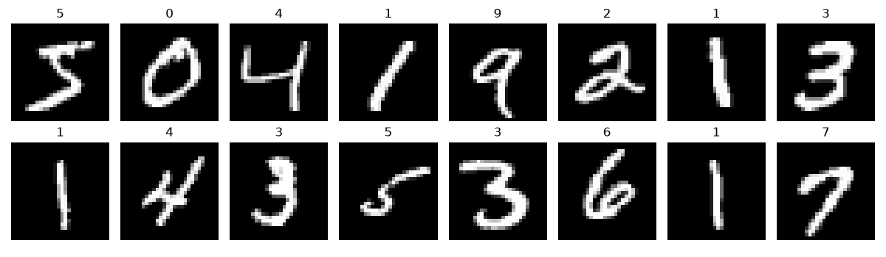
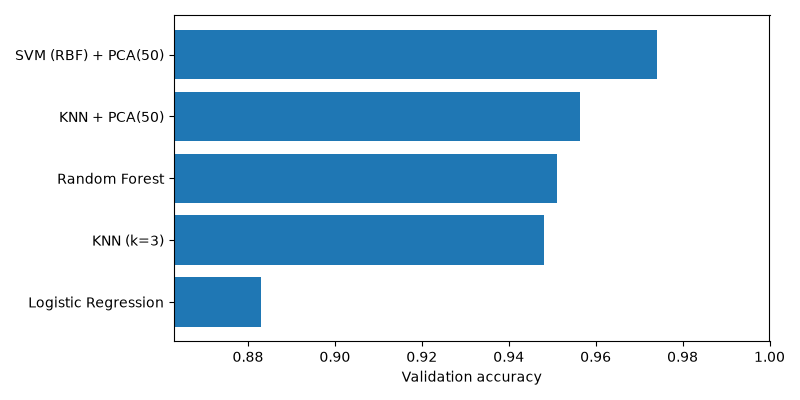
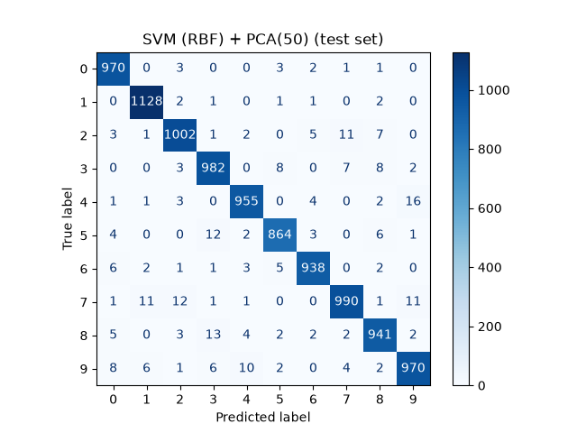
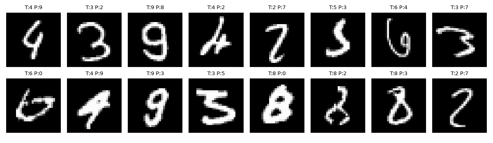

# Handwritten Digit Classification (MNIST)

Classifying handwritten digits (0-9) from 28×28 grayscale images using classic machine learning models. The project focuses on **data preprocessing** and on **comparing models** to find which one recognizes digits best.

## Dataset

The [MNIST dataset](https://www.kaggle.com/c/digit-recognizer) contains:

| Set | Images | Labels |
|-----|--------|--------|
| Training | 60,000 | yes |
| Test | 10,000 | yes |

Each image is 28×28 pixels (784 features) with values from 0 (black) to 255 (white).

**The data is not included in this repository.** Download it and extract the four files into a folder called `mnist/` next to the script:

```
mnist/
├── train-images.idx3-ubyte
├── train-labels.idx1-ubyte
├── t10k-images.idx3-ubyte
└── t10k-labels.idx1-ubyte
```

## Project Pipeline

1. **Load** the raw IDX binary files into NumPy arrays.
2. **Explore** the data: class balance, sample images, and the average image of each digit.
3. **Split** into train / validation / test sets (stratified) *before* any preprocessing, to avoid data leakage.
4. **Preprocess**:
   - Normalize pixel values from 0-255 to 0-1
   - Remove constant (always-black) pixels, learned from the training set only
   - Optional data augmentation: 1-pixel shifts in four directions
   - PCA (50 components) for the KNN and SVM pipelines
5. **Train and compare** five models on the validation set.
6. **Evaluate** the best model once on the held-out test set with a confusion matrix, per-digit accuracy, and an error analysis.

## Models Compared

- Logistic Regression
- K-Nearest Neighbors (k=3)
- K-Nearest Neighbors + PCA
- Random Forest
- Support Vector Machine (RBF kernel) + PCA

## Results

> Replace the values below with the output of your own run.

| Model | Validation accuracy | Training time (s) |
|-------|--------------------:|------------------:|
| Logistic Regression | _0.8829%_ | _1.4_ |
| KNN (k=3) | _0.9481%_ | _1.0_ |
| KNN + PCA(50) | _0.9565%_ | _0.3_ |
| Random Forest | _0.9510%_ | _1.3_ |
| SVM (RBF) + PCA(50) | _0.9741%_ | _3.8_ |

**Best model:** SVM(RBF) + PCA(50) with a **test accuracy of _0.9741%_**.

### Plots

<!--




-->


## How to Run

```bash
# 1. Clone the repository
git clone https://github.com/YOUR-USERNAME/mnist-digit-classifier.git
cd mnist-digit-classifier

# 2. (Optional) create a virtual environment
python -m venv .venv
.venv\Scripts\activate        # Windows
# source .venv/bin/activate   # macOS / Linux

# 3. Install dependencies
pip install -r requirements.txt

# 4. Put the MNIST files in ./mnist/ (see Dataset above), then run
python mnist_project_idx.py
```

### Settings

At the top of `mnist_project_idx.py`:

| Variable | Default | Meaning |
|----------|---------|---------|
| `N_TRAIN` | `10000` | Number of training images to use. Set to `None` for the full set (slower). |
| `AUGMENT` | `False` | Add 1-pixel shifted copies of the training images (5× more data). |

## Project Structure

```
mnist-digit-classifier/
├── mnist_project_idx.py   # full pipeline: load, preprocess, train, evaluate
├── requirements.txt
├── README.md
└── images/                # saved result plots
```

## Tools Used

Python, NumPy, pandas, scikit-learn, SciPy, Matplotlib

## Possible Improvements

- Hyperparameter tuning with `GridSearchCV` (SVM `C`, KNN `k`)
- Training on the full 60,000 images with augmentation
- A convolutional neural network (CNN) for comparison
- Cross-validation instead of a single validation split

## License

This project is for educational purposes. MNIST is a public dataset by Yann LeCun, Corinna Cortes, and Christopher J.C. Burges.
